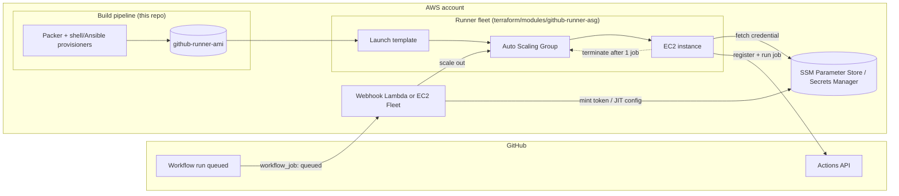
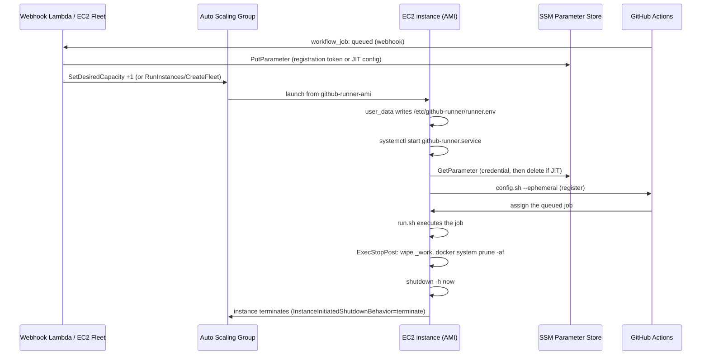

# github-runner-ami

An open-source Packer/Terraform toolkit that builds an Amazon Linux 2023 AMI for
**ephemeral, self-hosted GitHub Actions runners** on AWS: register, run exactly one
job, wipe state, terminate. No persistent fleet to patch, no job-to-job cross
contamination, no SSH.

[](https://github.com/jetonecloud/github-runner-ami/actions/workflows/validate.yml)
[](LICENSE)

## Features

- **Amazon Linux 2023**, built for both `x86_64` and `arm64` (Graviton) from a single
  Packer HCL2 template, selected via an explicit `-var-file`.
- **Preinstalled toolchain**: GitHub Actions runner (pinned + SHA-256 verified), Docker
  + buildx, git, AWS CLI v2 (GPG-signature verified), Node.js LTS, Python 3, Go, jq,
  unzip, and Trivy.
- **Ephemeral by design**: a systemd unit fetches a JIT config or registration token
  from SSM Parameter Store/Secrets Manager at boot, runs `config.sh --ephemeral`, runs
  exactly one job, wipes the workspace and Docker state, and shuts the instance down -
  which terminates it via `InstanceInitiatedShutdownBehavior=terminate`.
- **Two equivalent provisioning paths**: numbered shell scripts (the default, exercised
  by CI) or an Ansible playbook with a 1:1 role mapping - see
  [`ansible/README.md`](ansible/README.md).
- **Hardened**: IMDSv2 required, SSM Session Manager only (no SSH, no inbound security
  group rules needed), encrypted EBS volumes, least-privilege IAM instance profile, and
  an in-build Trivy filesystem scan that fails the AMI build on HIGH/CRITICAL findings.
  No secret is ever baked into the image.
- **Terraform module** for a launch template + scale-from-zero Auto Scaling Group, with
  guidance for driving capacity from a webhook/Lambda, EC2 Fleet, or the
  actions-runner-controller alternative.
- **CI/CD**: validation, an OIDC-authenticated build+scan+publish pipeline, an
  end-to-end smoke test, and a weekly rebuild for OS/runner updates.

## Architecture



### Ephemeral runner lifecycle



See [docs/architecture.md](docs/architecture.md) for the scale-out trade-offs
(webhook/Lambda + ASG vs. EC2 Fleet vs. actions-runner-controller).

## Repository layout

```
packer/                   HCL2 Packer template (shell provisioning path, default)
  scripts/                 Numbered provisioning scripts, run in order by build.pkr.hcl
  files/                   systemd unit, runner lifecycle scripts, Docker daemon.json
ansible/                   Equivalent Ansible playbook (alternative provisioning path)
terraform/
  modules/github-runner-asg/   Launch template + ASG + least-privilege IAM
  examples/basic/               Runnable example wiring up the module
test/
  smoke-test.sh             Boots the AMI, registers against a test repo, runs a job
  sample-workflow.yml       Workflow the smoke test dispatches (commit to your test repo)
.github/workflows/         validate.yml, build-ami.yml, weekly-rebuild.yml
docs/                       Architecture, cost comparison, security, troubleshooting
```

## Quick start

### Prerequisites

- [Packer](https://developer.hashicorp.com/packer/downloads) >= 1.10 and an AWS account
  with permission to build AMIs (EC2 run/describe/create-image, IAM read).
- [Terraform](https://developer.hashicorp.com/terraform/downloads) >= 1.7 to deploy the
  example.
- A GitHub repository or organization to register runners against, and a way to mint a
  registration token or JIT config for it (a small webhook/Lambda in production - see
  [docs/architecture.md](docs/architecture.md); for a one-off test, `gh api` as shown in
  `test/smoke-test.sh`).

### 1. Build the AMI

```bash
packer init packer/
packer build -var-file=packer/x86_64.pkrvars.hcl packer/
# or:
packer build -var-file=packer/arm64.pkrvars.hcl packer/
```

This runs every script in `packer/scripts/` in order, including an in-build Trivy scan
(`95-trivy-scan.sh`) that fails the build on HIGH/CRITICAL filesystem findings. The
resulting AMI ID is written to `packer/manifest.json`. Prefer Ansible? See
[`ansible/README.md`](ansible/README.md) for the drop-in equivalent.

### 2. Deploy the fleet

```bash
cd terraform/examples/basic
cp terraform.tfvars.example terraform.tfvars   # fill in ami_id, vpc_id, github_url, etc.
terraform init
terraform apply
```

This creates a launch template (IMDSv2 required, encrypted root volume, no SSH key) and
an Auto Scaling Group with `desired_capacity = 0` by default - nothing runs until
something drives capacity. See
[docs/architecture.md#scale-out-guidance](docs/architecture.md#scale-out-guidance) for
wiring up a webhook/Lambda, EC2 Fleet, or switching to actions-runner-controller
entirely.

### 3. Smoke test

```bash
# Commit test/sample-workflow.yml to <owner>/<repo>/.github/workflows/sample-workflow.yml first.
export AMI_ID=ami-0123456789abcdef0
export SUBNET_ID=subnet-0123456789abcdef0
export SECURITY_GROUP_ID=sg-0123456789abcdef0
export INSTANCE_PROFILE_NAME=github-runner-...        # from the terraform output iam_instance_profile_name
export TEST_REPO=your-org/your-repo
export GITHUB_TOKEN=ghp_...                            # needs Actions: write on TEST_REPO
./test/smoke-test.sh
```

## Cost comparison (summary)

Self-hosted runners trade GitHub's per-minute billing for EC2 compute cost - the
break-even point depends heavily on your usage pattern (job duration, concurrency,
Linux vs. larger runners). Full numbers and assumptions in
[docs/cost-comparison.md](docs/cost-comparison.md); summary for a Linux 2-vCPU job:

| Runner                                  | Effective cost per job-minute* |
| ---------------------------------------- | ------------------------------- |
| GitHub-hosted (`ubuntu-latest`, 2-core)  | $0.008                          |
| Self-hosted, `m6i.large` on-demand       | ~$0.0017                        |
| Self-hosted, `m6i.large` Spot (~70% off) | ~$0.0005                        |
| Self-hosted, `m6g.large` (Graviton) Spot | ~$0.0004                        |

\* Self-hosted figures are raw EC2 compute cost only; they exclude the minute or so of
boot/registration overhead per ephemeral job and any Lambda/data-transfer cost, both of
which are small but non-zero - see the full breakdown for the math.

## Security notes (summary)

- **No SSH, ever.** `sshd` is disabled in the AMI; access is via SSM Session Manager,
  which needs no inbound security group rule.
- **IMDSv2 required** at both the Packer build instance and the Terraform launch
  template (`http_tokens = "required"`, hop limit 1).
- **No secrets in the image.** The runner's credential (registration token or one-time
  JIT config) is fetched from SSM Parameter Store/Secrets Manager at boot and never
  written to disk outside the running instance's lifetime.
- **Least privilege IAM**: the instance role gets `AmazonSSMManagedInstanceCore` plus a
  policy scoped to exactly the credential parameter/secret ARNs you pass in - no
  `ec2:TerminateInstances` (self-shutdown handles that), no wildcard SSM/Secrets access.
- **Encrypted EBS** on both the AMI's root volume and every launched instance.
- **Supply chain**: every third-party binary (runner, Node.js, Go, Trivy, buildx) is
  pinned by version and verified by SHA-256; the AWS CLI is verified by GPG signature.
  Trivy gates the build itself.

Full threat model in [docs/security.md](docs/security.md).

## Troubleshooting (summary)

| Symptom                                   | Likely cause                                                             |
| ------------------------------------------ | -------------------------------------------------------------------------- |
| Instance boots but never registers         | `/etc/github-runner/runner.env` missing/malformed, or IAM can't read the SSM parameter/secret |
| Instance never terminates after a job      | Check `journalctl -u github-runner` via SSM Session Manager for the `ExecStopPost` cleanup step |
| Packer build fails during Trivy scan       | A HIGH/CRITICAL CVE landed in an installed package; bump the affected tool's pinned version |
| `packer build` can't reach the instance    | Build subnet needs internet/NAT (or the relevant VPC endpoints) to reach the Amazon Linux repos and GitHub/Node/Go/Trivy download hosts |

Full guide in [docs/troubleshooting.md](docs/troubleshooting.md).

## Contributing

See [CONTRIBUTING.md](CONTRIBUTING.md) for the development setup and validation
commands. Security issues go through [SECURITY.md](SECURITY.md), not public issues.

## License

[Apache License 2.0](LICENSE).
