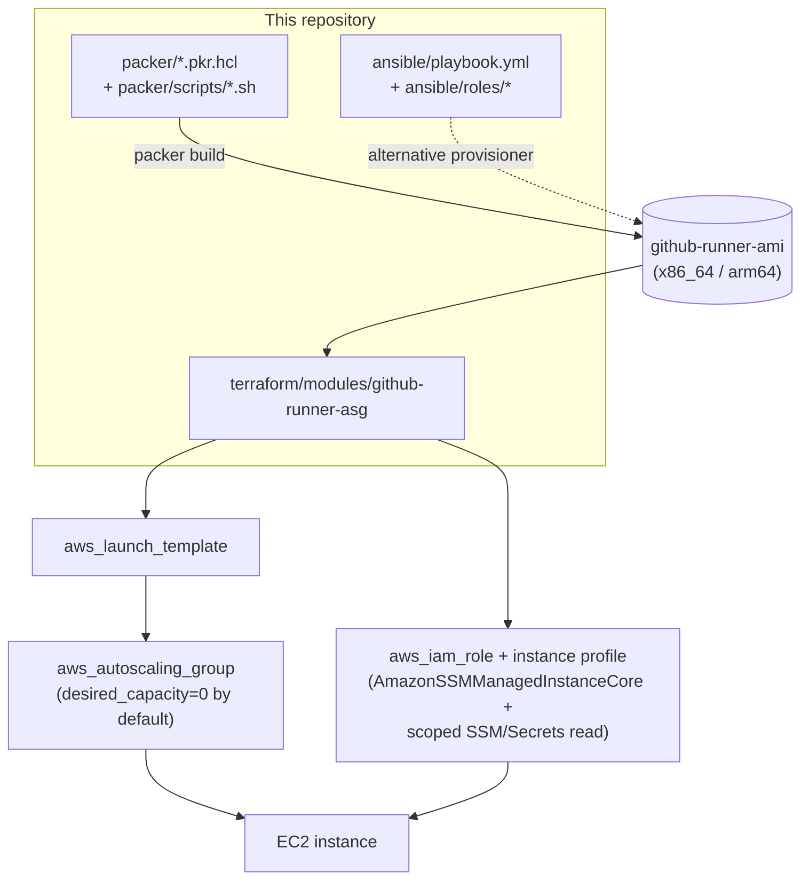

# Architecture

## Components

The AMI itself is produced by `packer/` (default, exercised by CI) or the equivalent
`ansible/playbook.yml` (see [`ansible/README.md`](../ansible/README.md)). Either path
produces the same filesystem layout:

| Path                                 | Contents                                                              |
| -------------------------------------- | ------------------------------------------------------------------------ |
| `/opt/actions-runner/`                 | GitHub Actions runner binary (owned by the `runner` user)             |
| `/opt/actions-runner/_work/`           | Job workspace; wiped between jobs                                       |
| `/opt/github-runner/bin/`               | `runner-register.sh`, `runner-start.sh`, `runner-cleanup.sh`, `fetch-runner-token.sh` |
| `/etc/systemd/system/github-runner.service` | The lifecycle unit (not enabled by default - see below)         |
| `/etc/github-runner/runner.env`         | Written by Terraform's `user_data` at boot, **not** baked into the AMI |
| `/etc/docker/daemon.json`               | Log rotation + overlay2 storage driver                                 |

## Ephemeral lifecycle, in detail

`packer/scripts/85-install-runner-service.sh` deliberately does **not**
`systemctl enable github-runner.service`. If it did, systemd might try to start it
during normal boot, before cloud-init has run the launch template's `user_data` and
written `/etc/github-runner/runner.env` - a race. Instead:

1. The instance boots; cloud-init runs `user_data.sh.tpl`, which writes
   `/etc/github-runner/runner.env` (repo/org URL, labels, where the credential lives -
   never the credential itself) and then runs `systemctl start github-runner.service`
   explicitly.
2. `ExecStartPre` (`runner-register.sh`, running as the unprivileged `runner` user)
   resolves this instance's credential:
   - **Registration-token mode** (`USE_JIT_CONFIG=false`, the default): reads a
     short-lived registration token from SSM/Secrets Manager and runs
     `config.sh --unattended --ephemeral ...`.
   - **JIT-config mode** (`USE_JIT_CONFIG=true`): reads a single-use JIT config
     (produced ahead of time by `POST /actions/runners/generate-jitconfig`) from a
     `{instance_id}`-templated parameter path, writes it to `.jitconfig`, and deletes
     the parameter so it can never be read twice.
3. `ExecStart` (`runner-start.sh`) runs `run.sh` (or `run.sh --jitconfig ...`). Because
   the runner was configured `--ephemeral`, it exits on its own after exactly one job.
4. `ExecStopPost` (`runner-cleanup.sh`, running **as root** via the `+` prefix in the
   unit file) always runs - whether the job succeeded, failed, or registration itself
   failed. It removes any leftover credential files, wipes `_work`, runs
   `docker system prune -af --volumes`, and calls `shutdown -h now`.
5. Because the launch template sets `instance_initiated_shutdown_behavior = "terminate"`,
   that OS shutdown **terminates the EC2 instance** - no `ec2:TerminateInstances` IAM
   permission is needed on the instance role.

This means a stuck/failed registration still results in a clean termination, which is
what you want from an Auto Scaling Group or Lambda-driven fleet: a bad instance doesn't
linger, it just disappears and gets replaced.

## Scale-out guidance

The Terraform module creates a launch template and an Auto Scaling Group, but **an
Auto Scaling Group alone does not know when a GitHub Actions job is queued.** Something
has to drive capacity. Three options, in increasing order of operational complexity:

### 1. Webhook Lambda + ASG desired capacity (what this module is shaped for)

A small Lambda subscribes to GitHub's `workflow_job` webhook:

- On `queued`: mint a registration token (or a JIT config) for the job's repo/org,
  write it to SSM at a path the Lambda controls, and increase the ASG's
  `desired_capacity`. The module's `aws_autoscaling_group` has
  `lifecycle { ignore_changes = [desired_capacity] }` specifically so Terraform doesn't
  fight the Lambda's live adjustments.
- On `completed`: decrease `desired_capacity` back down (bookkeeping an in-flight count
  is the main implementation complexity here - a DynamoDB counter or the ASG's own
  current instance count both work).

Pros: reuses the ASG's instance refresh/health check machinery. Cons: desired-capacity
bookkeeping can drift if the Lambda and the self-terminating instances disagree about
how many jobs are in flight.

### 2. EC2 Fleet / RunInstances per job (no desired-capacity bookkeeping)

The same Lambda calls `ec2:RunInstances` (or `CreateFleet` with
`Type=instant`) directly, referencing the module's `launch_template_id` output, once per
queued job. Each instance still self-terminates via the same AMI/systemd lifecycle. No
ASG desired-capacity accounting is needed because there's no ASG in the loop for
scaling decisions - 1 queued job = 1 `RunInstances` call = 1 instance that disappears on
its own. This is the pattern used by projects like
[philips-labs/terraform-aws-github-runner](https://github.com/philips-labs/terraform-aws-github-runner).
You can still keep the module's ASG around for a small always-on warm pool
(`min_size = max_size = desired_capacity = N`) alongside Fleet-launched burst capacity.

### 3. actions-runner-controller (Kubernetes alternative)

If you already run EKS (or any Kubernetes cluster) and would rather not manage AMIs and
EC2 fleets at all,
[actions/actions-runner-controller](https://github.com/actions/actions-runner-controller)
(now part of `actions/actions-runner-controller` / the `gha-runner-scale-set` Helm
chart) runs ephemeral runners as Kubernetes pods with built-in autoscaling against the
same webhook events. It's a materially different operational model (pods, not EC2
instances) - worth evaluating instead of this repo if Kubernetes is already your
primary compute platform; this repo is for teams who want EC2-native ephemeral runners
without a Kubernetes dependency.

| Approach                         | Scale-to-zero | Extra infra to build       | Best for                                |
| ---------------------------------- | -------------- | ----------------------------- | ------------------------------------------ |
| Webhook Lambda + ASG desired capacity | Yes         | Lambda + webhook + counter   | Teams comfortable owning ASG semantics   |
| EC2 Fleet / RunInstances per job   | Yes            | Lambda + webhook             | Tightest 1:1 job-to-instance mapping      |
| actions-runner-controller (k8s)    | Yes            | Kubernetes cluster            | Teams already running EKS/Kubernetes      |

## Credential flow

No credential is ever stored in the AMI or committed to this repo. At runtime, exactly
one of two things lives in SSM Parameter Store/Secrets Manager, scoped by IAM to the
runner fleet's instance role:

- A **registration token** (`POST /repos/{owner}/{repo}/actions/runners/registration-token`
  or the org equivalent), valid ~1 hour and usable by any number of instances until it
  expires or is rotated. Simple, but not strictly single-use.
- A **JIT config** (`POST /actions/runners/generate-jitconfig`), valid for one
  registration only. The module supports a `{instance_id}`-templated parameter path so a
  scale-out Lambda can mint one per instance; `runner-register.sh` deletes the parameter
  immediately after reading it.
